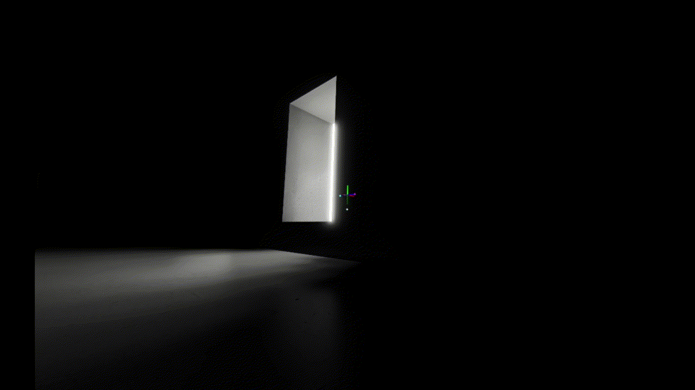
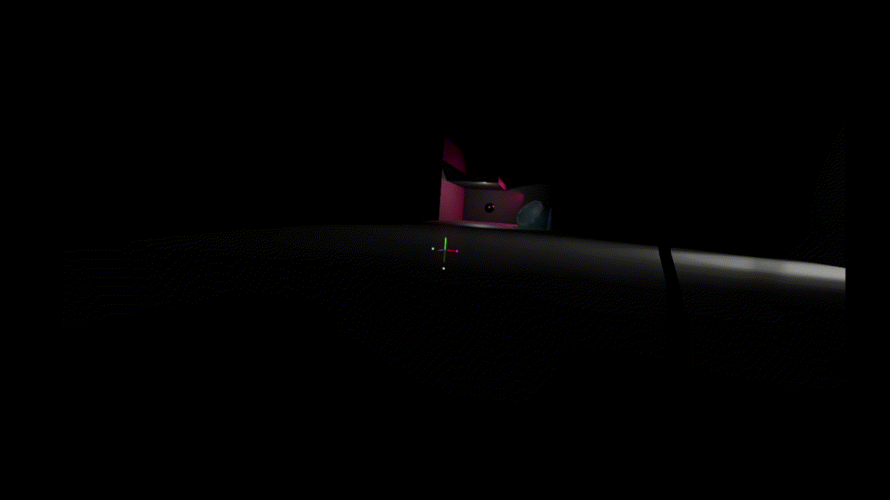

# Walking Simulator

An experimental game with a complex physics-based character controller. Includes bunny hopping, gravity switching, and of course some QOL leaning and viewbobbing animations.

| Movement | Bunny‑hop | Gravity switch |
|----------|-----------|----------------|
|  |  |  |

## Features  

- Rigidbody based character controller.

**Advanced movement mechanics**:
- Bunny hopping with parameters to control momentum.
- Arbitrary gravity switching: Set the direction of gravity to any vector. Other features like jumping, camera view, and viewbobbing adjust accordingly.

**QOL**:
- Smooth view‑bobbing that reacts to speed, jumps, and gravity changes.
- Camera lean based on horizonal movement.
- Optional camera smoothing.

## Controls  

| Action | Key |
|--------|--------------|
| Look | Mouse movement |
| Move | `WASD` |
| Jump | `Space` |
| Snap gravity to view | `Shift` |
| Roll gravity | `Q` & `E` |

